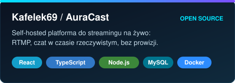

# Cześć, jestem Patryk! 👋

Jestem Developerem i doświadczonym informatykiem z solidnym zapleczem w programowaniu oraz zarządzaniu infrastrukturą IT. Szukam możliwości rozwoju w obszarze architektury systemów i chmury, gdzie mogę tworzyć innowacyjne oraz skalowalne rozwiązania.

### 👨‍💻 O mnie
* 🎓 Studiuję Informatykę (specjalizacja: Programowanie Systemów Informatycznych) na Politechnice Morskiej w Szczecinie.
* 🛠 Posiadam kwalifikacje Technika Informatyka (INF.02, INF.03).
* 🔭 Obecnie pracuję m.in. nad moją pracą inżynierską dotyczącą systemu rankingowego opartego na algorytmach wielokryterialnej oceny obiektów.
* 🎮 W wolnym czasie interesuję się projektowaniem gier, rozwiązaniami IoT, a po godzinach gram w CS2, Minecrafta, RPG-i i działam na strzelankach ASG.
* 💬 Zapytaj mnie o: Python, C++ lub optymalizację i tworzenie bezpiecznych relacyjnych baz danych (MySQL, PostgreSQL).
* 📫 Jak się ze mną skontaktować: patrykmarkiewicz2004@gmail.com

### 📌 Wyróżnione projekty

  
  

### 🎮 Steam

  

### 🛠 Technologie i narzędzia, z którymi pracuję:

**Języki Programowania:**
* Python | C++ | C# | Java | JavaScript / TypeScript | PHP | Lua | MATLAB

**Backend i Bazy Danych:**
* Node.js / Express | Django / Flask | REST API | Socket.io | JWT/Auth
* MySQL | PostgreSQL | SQLite | SQL

**Frontend i Systemy:**
* HTML5 | CSS3
* Git / GitHub | Docker | Linux / Windows | Android SDK
